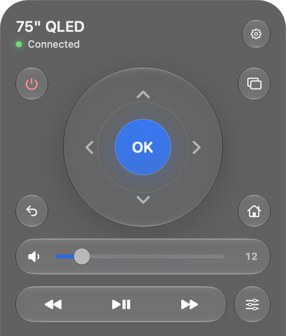

# Samsung TV Remote for Mac

A menu bar remote for Samsung Tizen TVs. Native SwiftUI, no dependencies, no account. It talks to the TV over your local network. The only internet request fetches app icons from Apple.



## What it does

- Direction pad, OK, Back, Home, Inputs, TV menu and power. Power wakes the TV with Wake-on-LAN when it is off.
- A volume slider that shows the TV's real level, 0 to 100.
- One play/pause button, plus rewind and fast forward.
- Typing on the TV. When the TV opens a text field, the remote switches to a keyboard and mirrors what you type.
- Favourite apps as icons. Choose and order them in Settings.

While the panel is open, the arrow keys move, Return is OK, Esc or Delete goes back, and + and − change the volume. Any other letter starts typing on the TV.

## Install

```sh
scripts/build-app.sh
```

This builds `build/Samsung TV Remote.app` for Apple silicon and Intel, plus a zip to share. Copy the app to Applications and open it. Click the remote icon in the menu bar, pick your TV and choose Allow on the TV. Allow Local Network access if macOS asks.

The app is ad-hoc signed and not notarized. On another Mac, open it the first time with Control-click → Open.

## How it works

The remote uses the TV's WebSocket API on port 8002. It accepts Samsung's self-signed certificate only for the selected TV. The pairing token lives in `~/Library/Application Support/SamsungMenuRemote/credentials.json` with mode 600, outside the repository.

The WebSocket API has no absolute volume, so the slider uses the TV's UPnP RenderingControl service on port 9197. TVs without it get − / mute / + buttons instead.

There is no brightness slider. The test TV rejects brightness over UPnP, and I found no local or SmartThings API for it.

Samsung has no play/pause key that works in every app. The single button alternates between pause and play, so after pausing with the TV's own remote the first click may repeat the command.

## Tested on

A 2024 QLED, `QE75Q74DATXXN`, in October 2026. Pairing, reconnecting, volume and reading the volume work. Power, inputs, app launching and typing still need a full manual check. This TV does not list its installed apps, so the app checks a catalog of about 50 known app IDs against it. You can add any other app ID in Settings.

## Development

```sh
scripts/check.sh
```

This runs the protocol, discovery, volume and Wake-on-LAN checks. Set `SAMSUNG_TEST_HOST` to the TV's IP to also run read-only checks against a real TV. They never send remote keys. Shared sizes, spacing and type live in `Sources/SamsungTVRemote/Design.swift`.

Protocol references are [samsung-tv-ws-api](https://github.com/xchwarze/samsung-tv-ws-api) and [universal-tv-remote-macos](https://github.com/devasheeshG/universal-tv-remote-macos). This code is written independently; nothing was copied from either.
